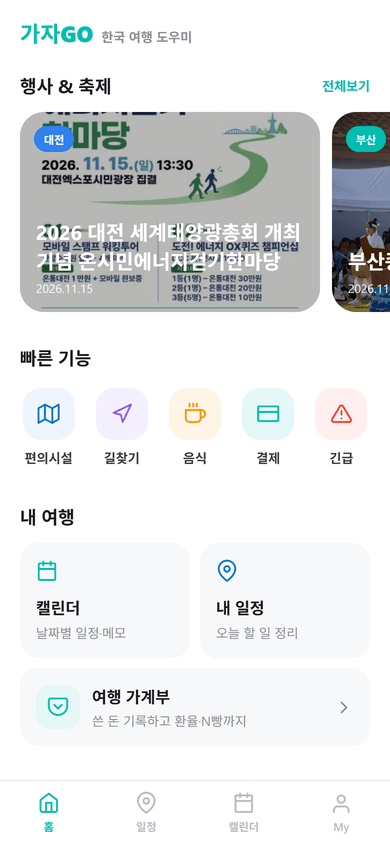
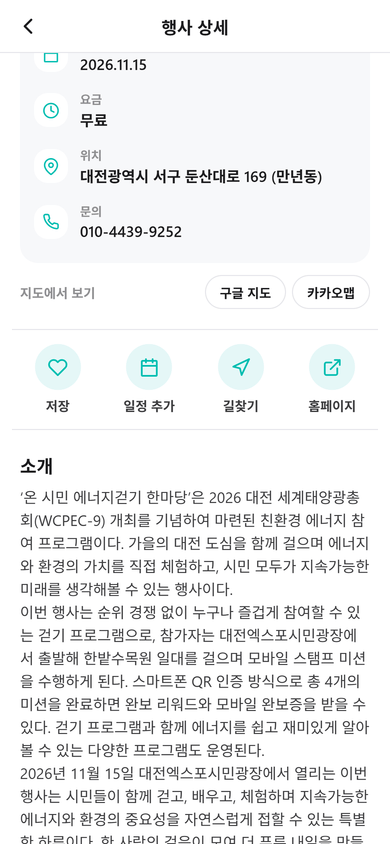
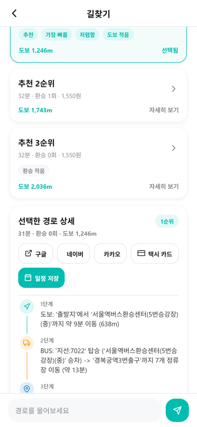
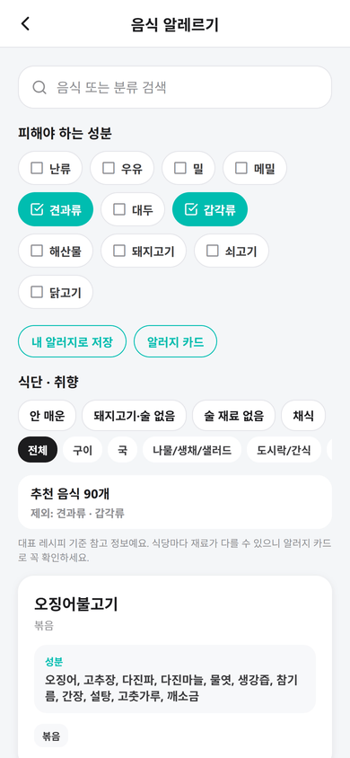
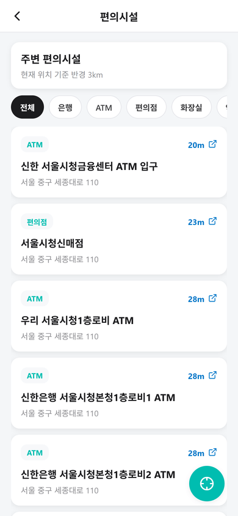
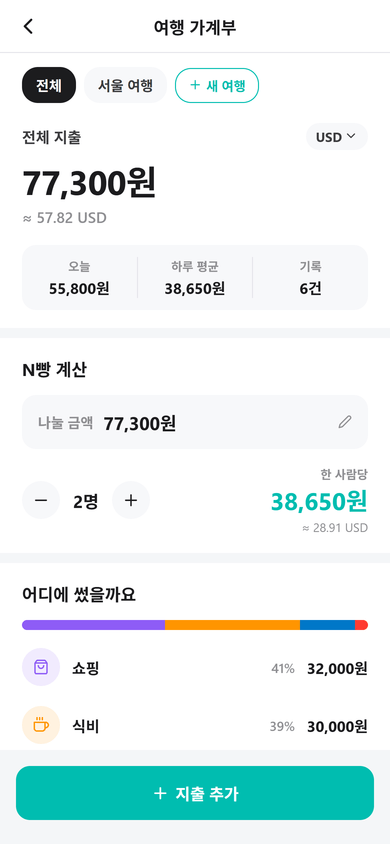
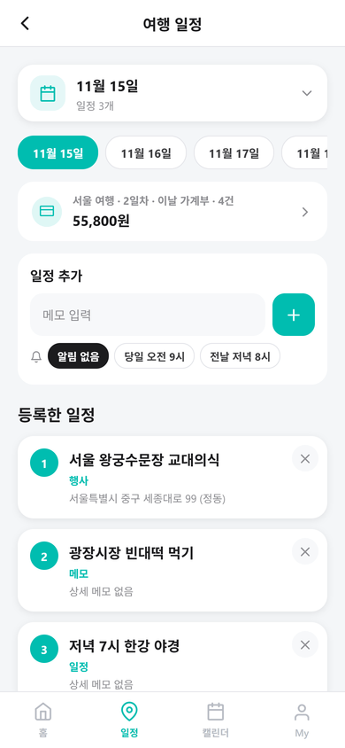
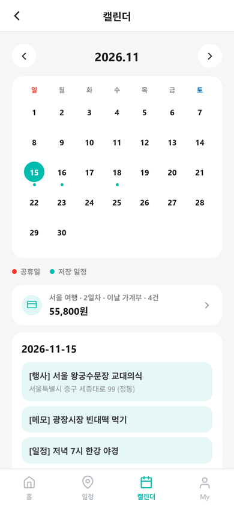
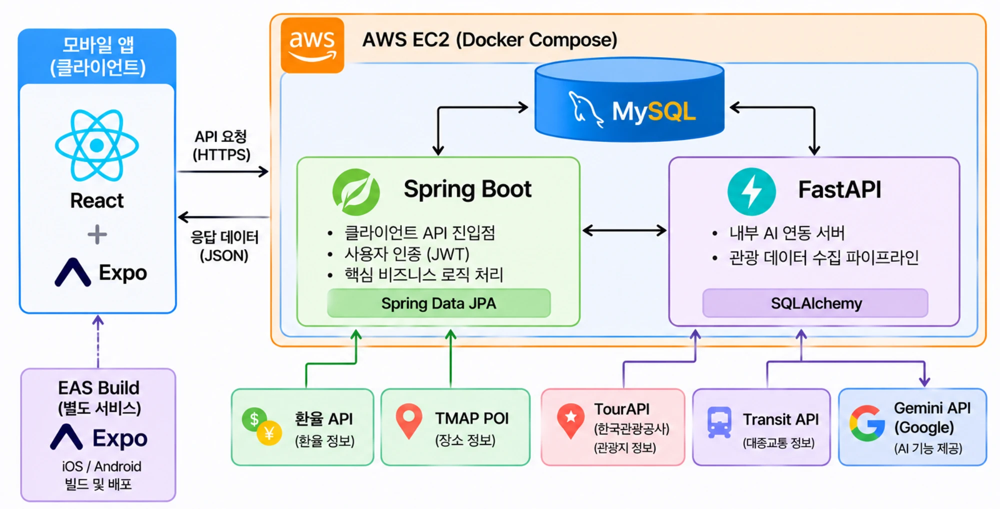

  

<h2 align="center">가자GO</h2>

외국인 여행자를 위한 한국 여행 도우미 앱 (행사·길찾기·음식 알레르기·편의시설·일정·가계부)

  
  
  
  
  
  
  
  

---

## 📦 Repositories

| 레포 | 설명 | 기술 |
| --- | --- | --- |
| [**gajaGO-web**](https://github.com/Dankook-gajaGO/gajaGO-web) | 모바일 앱 (Android APK · Web) | React Native, Expo, TypeScript |
| [**gajaGo-server**](https://github.com/Dankook-gajaGO/gajaGo-server) | 메인 API · AI 교통 챗봇 · 축제 수집기 | Spring Boot, FastAPI, MySQL, Docker |

---

## 📱 시연 화면

<table>
  <tr>
    <td align="center"> <b>홈</b></td>
    <td align="center"> <b>행사 상세</b></td>
    <td align="center"> <b>교통 챗봇 경로</b></td>
    <td align="center"> <b>음식 알레르기</b></td>
  </tr>
  <tr>
    <td align="center"> <b>주변 편의시설</b></td>
    <td align="center"> <b>여행 가계부</b></td>
    <td align="center"> <b>내 일정</b></td>
    <td align="center"> <b>캘린더</b></td>
  </tr>
</table>

---

## ✨ 주요 기능

| 영역 | 핵심 기능 | 비회원 | 회원 |
| --- | --- | :---: | :---: |
| 🎉 행사·축제 | 최근·곧 열리는 행사 추천, 상세, 지도(구글·카카오), 행사장으로 바로 길찾기 | ✅ | ✅ |
| 🚇 교통 챗봇 | 자연어 길찾기, 현재 위치 출발, TMAP(실패 시 카카오) 경로 3개와 Gemini 추천 순위 | ✅ | ✅ |
| 🍜 음식 알레르기 | 알레르기 11종 + 식단·취향 필터 (안 매운·채식·돼지고기·술 없음) | ✅ | ✅ |
| 🪪 보여주기 카드 | 알레르기·도움 요청을 한국어 카드로 제시 | ✅ | ✅ |
| 🏧 편의시설 | 은행·ATM·편의점·화장실·약국·지하철역·환전소 | ✅ | ✅ |
| 💰 여행 가계부 | 10개 외화 환산, 여행별 집계, N빵, 영수증 이미지 공유 | ✅ (앱을 끄면 삭제) | ✅ (서버 저장) |
| 📅 일정·캘린더 | 행사·경로·메모 저장, 여행 N일차, 이날 가계부, 선택형 알림 | - | ✅ |
| 🆘 긴급 | 112·119·1330 원터치 전화, 도움 요청 카드 | ✅ | ✅ |

---

## 🏗 시스템 아키텍처

  

---

## 🛠 기술 스택

| 영역 | 기술 |
| --- | --- |
| Mobile | React Native, Expo, TypeScript, React Navigation, AsyncStorage, Expo Location, Expo Notifications |
| Backend | Java 17, Spring Boot, Spring Security (JWT · BCrypt), Spring Data JPA, MySQL |
| AI / Transport | FastAPI, Gemini API, TMAP POI · Transit API, Kakao 대중교통 경로(예비) |
| Data | 한국관광공사 TourAPI, 환율 API |
| Infra | Docker Compose, AWS EC2, EAS Build |

---

## 🛣 로드맵

- [x] AI 교통 챗봇 · 현재 위치 출발 · 행사장 바로 길찾기
- [x] 알레르기 프로필 저장 · 식단 필터 · 보여주기 카드
- [x] 여행 가계부 · 환율 환산 · 영수증 공유
- [x] TourAPI 행사 자동 수집
- [x] AWS EC2 상시 배포
- [ ] 🌏 영어 · 중국어 · 일본어 다국어 지원
- [ ] 📷 메뉴판 OCR + Gemini 재료 추론
- [ ] 🗺 앱 내부 지도 마커 · 경로 시각화
- [ ] 🔒 HTTPS · 도메인 연결 · 모니터링

---

<b>Team 가자GO</b> · 단국대학교

  

