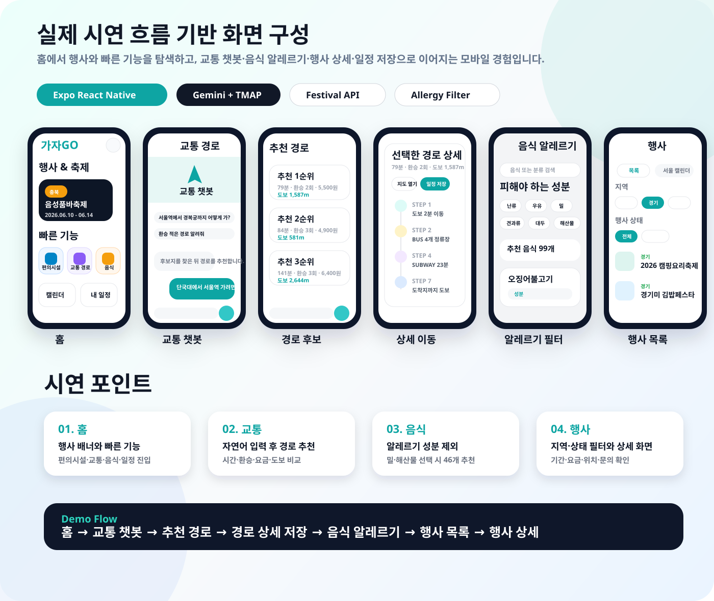

<p align="center">
  
</p>

<h2 align="center">가자GO · Dankook University</h2>

<p align="center">
  <b>AI 자연어 이해 · TMAP 실시간 교통 데이터 · 지역 행사 정보를 연결한 외국인 한국 여행 지원 모바일 앱</b>
</p>

<p align="center">
  
  
  
  
  
  
  
</p>

---

## 📦 Repositories

| 레포 | 설명 | 기술 |
| --- | --- | --- |
| [**gajaGO-web**](https://github.com/Dankook-gajaGO/gajaGO-web) | 모바일 앱 (Android APK · Web) | React Native, Expo, TypeScript |
| [**gajaGo-server**](https://github.com/Dankook-gajaGO/gajaGo-server) | 메인 API · AI 교통 챗봇 · 축제 수집기 | Spring Boot, FastAPI, MySQL, Docker |

---

## Overview

| 항목 | 내용 |
| --- | --- |
| 서비스 목표 | 외국인 여행자가 한국 여행 중 필요한 행사, 교통, 음식, 편의시설, 일정, 지출을 하나의 앱에서 확인할 수 있도록 지원 |
| 핵심 흐름 | 홈 → 교통 챗봇 → 추천 경로 비교 → 경로 상세 저장 → 음식 알레르기 필터 → 행사 탐색 |
| 차별점 | Gemini 자연어 분석과 TMAP 실시간 교통 데이터를 연결해 실제 이동 가능한 경로를 추천 |
| 이용 원칙 | 기능은 누구나 사용, **저장·기록(개인화)만 로그인** 필요 |

---

## 📱 시연 화면

<p align="center">
  
</p>

---

## ✨ 주요 기능

| 영역 | 핵심 기능 | 비회원 | 회원 |
| --- | --- | :---: | :---: |
| 🎉 행사·축제 | 최근·곧 열리는 행사 추천, 상세, 지도(구글·카카오·네이버), 길찾기 | ✅ | ✅ |
| 🚇 AI 교통 챗봇 | 자연어 길찾기, 현재 위치 출발, Gemini 경로 순위·이유 | ✅ | ✅ |
| 🍜 음식 알레르기 | 알레르기 11종 + 식단·취향 필터 (안 매운·채식·돼지고기 없음) | ✅ | ✅ |
| 🪪 보여주기 카드 | 알레르기·택시·도움 요청을 한국어 카드로 직원·기사에게 제시 | ✅ | ✅ |
| 🏧 편의시설 | 은행·ATM·편의점·화장실·약국·지하철역·환전소 | ✅ | ✅ |
| 💰 여행 가계부 | 11개 통화 환율 환산, 여행별 집계, N빵, 영수증 이미지 공유 | ✅ | ✅ |
| 📅 일정·캘린더 | 행사·경로·메모 저장, 여행 N일차, 이날 가계부 | - | ✅ |
| 🆘 긴급 | 112·119·1330 원터치 전화, 도움 요청 카드 | ✅ | ✅ |

<details>
<summary><b>기능 자세히 보기</b></summary>

### AI 교통 경로 추천
- "짐이 많은데 홍대입구역에서 명동까지 환승 적게"처럼 자연어로 입력하면 출발지·목적지·조건을 추출합니다.
- 출발지를 말하지 않으면 현재 위치에서 출발합니다.
- TMAP 대중교통 경로 후보를 Gemini가 사용자 조건에 맞춰 1~3순위로 정렬하고 이유를 붙입니다.
- 경로 상세에서 도보·버스·지하철 단계를 확인하고 택시 카드, 일정 저장을 사용할 수 있습니다.

### 행사 & 축제
- 한국관광공사 TourAPI에서 매일 새벽 4시에 행사 정보를 자동 수집합니다.
- 곧 시작하거나 최근 시작한 행사를 오늘과 가까운 순으로 추천합니다.

### 음식 알레르기 필터링
- 난류, 우유, 밀, 메밀, 견과류, 대두, 갑각류, 해산물, 돼지고기, 쇠고기, 닭고기 중 피할 성분을 선택합니다.
- 간장·고추장의 밀, 냉면의 메밀처럼 숨은 성분도 보수적으로 매핑합니다.

### 여행 가계부
- 앱 내 숫자 키패드로 빠르게 기록하고, 서버가 12시간마다 갱신한 환율로 자국 통화 환산을 보여줍니다.
- 여행(이름+기간)별로 지출을 모아 보고, 기간을 골라 영수증 이미지로 공유합니다.

</details>

---

## 🏗 시스템 아키텍처

```text
📱 App (Expo React Native)
 └─ Spring Boot API (:8080) ── MySQL
     ├─ 회원 인증 / JWT
     ├─ 행사 · 음식 · 일정 · 가계부 데이터
     ├─ FastAPI 교통 챗봇 ── Gemini (자연어 분석·경로 순위)
     │                      └─ TMAP (POI / 대중교통)
     ├─ TMAP 주변 편의시설
     └─ 환율 API (12시간 캐시)

🗓 Festival Collector ── TourAPI (시작 시 + 매일 04:00)
🐳 docker compose 4 containers · AWS EC2
```

---

## 🛠 기술 스택

| 영역 | 기술 |
| --- | --- |
| Mobile | React Native, Expo, TypeScript, React Navigation, AsyncStorage, Expo Location |
| Backend | Spring Boot, Spring Security (JWT), JPA, MySQL |
| AI / Transport | FastAPI, Gemini API, TMAP API |
| Data | 한국관광공사 TourAPI, 환율 API |
| Infra | Docker Compose, AWS EC2, EAS Build |

---

## 🚀 Quick Start

```bash
# 서버 (Docker 필요, .env에 API 키 설정)
git clone https://github.com/Dankook-gajaGO/gajaGo-server.git
cd gajaGo-server && docker compose up -d

# 앱
git clone https://github.com/Dankook-gajaGO/gajaGO-web.git
cd gajaGO-web && npm install && npx expo start
```

자세한 설정은 각 레포의 README를 참고하세요.

---

<p align="center">
  
</p>
