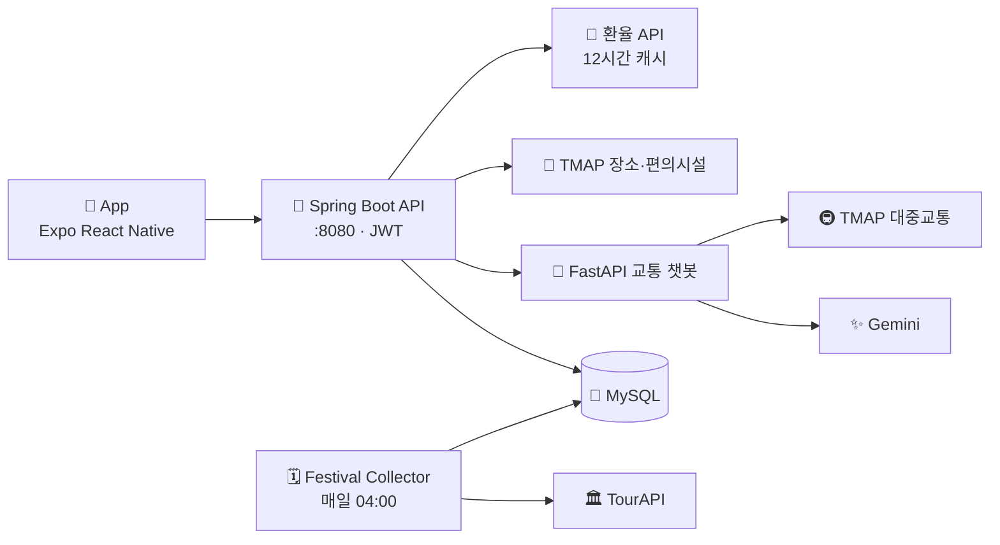

  

<h2 align="center">가자GO · 한국 여행, 앱 하나로 충분하게</h2>

  <b>“짐이 많은데 서울역까지 어떻게 가?” 한 문장이면 경로가 나오고, 
  알레르기를 고르면 먹을 수 있는 음식만 남는 외국인 여행자용 한국 여행 도우미</b>

  
  
  
  
  
  
  
  

  <a href="#-why-가자go">Why</a> ·
  <a href="#-가자go와-함께하는-하루">하루 시나리오</a> ·
  <a href="#-주요-기능">주요 기능</a> ·
  <a href="#-기존-서비스와-무엇이-다른가요">비교</a> ·
  <a href="#-기술-하이라이트">기술 하이라이트</a> ·
  <a href="#-로드맵">로드맵</a>

---

## 📦 Repositories

| 레포 | 설명 | 기술 |
| --- | --- | --- |
| [**gajaGO-web**](https://github.com/Dankook-gajaGO/gajaGO-web) | 모바일 앱 (Android APK · Web) | React Native, Expo, TypeScript |
| [**gajaGo-server**](https://github.com/Dankook-gajaGO/gajaGo-server) | 메인 API · AI 교통 챗봇 · 축제 수집기 | Spring Boot, FastAPI, MySQL, Docker |

---

## 🤔 Why 가자GO?

한국을 찾은 외국인 여행자는 여행 중 **앱 4~5개를 오가며** 정보를 찾습니다.

| 여행자가 겪는 문제 | 가자GO의 해결 |
| --- | --- |
| 😵 축제·행사 정보가 관광 포털, 지자체 사이트에 흩어져 있음 | 🎉 TourAPI 행사를 **매일 자동 수집**해 가까운 날짜 순으로 추천 |
| 🚇 노선·환승이 복잡하고, 짐이 많거나 걷기 힘들 땐 최단 경로가 정답이 아님 | 🤖 **자연어로 상황을 말하면** Gemini가 조건에 맞는 경로를 골라 이유와 함께 추천 |
| 🥜 메뉴 이름과 재료를 읽을 수 없어 알레르기 판단이 어려움 | 🍜 알레르기 11종 + 식단 필터로 **먹을 수 있는 음식만** 표시, 숨은 성분까지 매핑 |
| 🗣 한국어를 못해서 식당 직원·택시 기사에게 설명하기 어려움 | 🪪 알레르기·택시·도움 요청을 **큰 한국어 카드**로 화면 그대로 보여주기 |
| 💸 환율 계산, 일행과 비용 나누기가 번거로움 | 💰 11개 통화 환산, N빵, **영수증 이미지 공유**까지 되는 여행 가계부 |

> **가입 없이 바로 사용하세요.** 모든 탐색 기능은 비회원도 쓸 수 있고, 저장·기록할 때만 로그인을 요청합니다.

---

## 🗺 가자GO와 함께하는 하루

> 일본에서 온 여행자 **Yuki**는 땅콩 알레르기가 있고, 큰 캐리어를 끌고 서울에 도착했습니다.

| 시간 | 상황 | 가자GO에서 |
| :---: | --- | --- |
| ☀️ 09:00 | 오늘 갈 만한 곳을 찾는 중 | 홈 배너에서 **이번 주 열리는 축제**를 보고 관심 행사로 저장 |
| 🧳 10:30 | 캐리어를 끌고 숙소에서 축제장으로 | 챗봇에 *“짐이 많아서 환승 적게 가고 싶어”* 입력 → 출발지는 **현재 위치**로 자동 설정, 환승이 적은 경로 1순위 추천 |
| 🍜 12:30 | 점심 메뉴를 고르는 중 | 저장해 둔 **견과류 알레르기가 자동 적용**된 음식 목록 확인 → 식당에서 **알레르기 카드**를 직원에게 보여주기 |
| 🏧 15:00 | 현금이 필요해짐 | 주변 편의시설에서 **가장 가까운 ATM·환전소** 찾기 |
| 🚕 19:00 | 지쳐서 택시를 타기로 함 | 경로 상세의 **택시 카드**를 기사에게 보여주기 |
| 🌙 22:00 | 하루 정리 | 가계부에 지출 기록 → 엔화로 환산 확인 → 일행과 **N빵 영수증 이미지 공유** |

---

## 📱 시연 화면

  

---

## ✨ 주요 기능

| 영역 | 핵심 기능 | 비회원 | 회원 |
| --- | --- | :---: | :---: |
| 🎉 행사·축제 | 최근·곧 열리는 행사 추천, 상세, 지도(구글·카카오·네이버), 행사장으로 바로 길찾기 | ✅ | ✅ |
| 🚇 AI 교통 챗봇 | 자연어 길찾기, 현재 위치 출발, Gemini 경로 순위·추천 이유 | ✅ | ✅ |
| 🍜 음식 알레르기 | 알레르기 11종 + 식단·취향 필터 (안 매운·채식·돼지고기·술 없음) | ✅ | ✅ |
| 🪪 보여주기 카드 | 알레르기·택시·도움 요청을 한국어 카드로 제시 | ✅ | ✅ |
| 🏧 편의시설 | 은행·ATM·편의점·화장실·약국·지하철역·환전소 | ✅ | ✅ |
| 💰 여행 가계부 | 11개 통화 환산, 여행별 집계, N빵, 영수증 이미지 공유 | N빵 | ✅ |
| 📅 일정·캘린더 | 행사·경로·메모 저장, 여행 N일차, 이날 가계부, 선택형 알림 | - | ✅ |
| 🆘 긴급 | 112·119·1330 원터치 전화, 도움 요청 카드 | ✅ | ✅ |

<b>🚇 AI 교통 챗봇 자세히 보기</b>

 

1. *“단국대에서 서울역 가려면 짐이 많은데 어떻게 가?”* 처럼 자연어로 질문합니다.
2. Gemini가 **출발지 · 목적지 · 사용자 조건**(짐, 환승, 도보 등)을 추출합니다. 출발지가 없거나 “여기서”라고 하면 GPS 현재 위치를 씁니다.
3. TMAP 장소 검색으로 후보를 보여주고, 사용자가 확정합니다.
4. TMAP 대중교통 경로 3개를 받아 **Gemini가 조건에 맞게 1~3순위와 이유**를 붙입니다.
5. 경로 상세에서 도보·버스·지하철 단계를 확인하고, 지도 앱으로 열거나 택시 카드·일정 저장을 할 수 있습니다.

<b>🍜 음식 알레르기 필터 자세히 보기</b>

 

- **알레르기 11종:** 난류, 우유, 밀, 메밀, 견과류, 대두, 갑각류, 해산물, 돼지고기, 쇠고기, 닭고기
- **숨은 성분 보강:** 간장·고추장의 밀, 냉면의 메밀처럼 놓치기 쉬운 재료도 보수적으로 매핑했습니다.
- **자동 검증:** 데이터 생성 스크립트에서 모든 알레르기 항목이 실제로 음식을 1개 이상 걸러내는지 검사합니다.
- **식단 필터:** 안 매운 음식, 돼지고기·술 없음, 채식 등 종교·식습관이 다른 여행자도 쓸 수 있습니다.
- **내 알레르기 저장(회원):** 음식 화면을 열면 저장한 알레르기가 자동으로 선택됩니다.

<b>💰 여행 가계부 자세히 보기</b>

 

- 여행(이름+기간)을 만들고 날짜별 지출을 분류와 함께 기록합니다.
- KRW와 USD, JPY, CNY, TWD, HKD, EUR, THB, VND, PHP, SGD로 환산해 볼 수 있습니다.
- 일행 인원을 정하면 10원 단위로 N빵을 계산합니다.
- 기간을 골라 **영수증 이미지**로 만들어 카카오톡·라인으로 공유합니다.
- 캘린더에서 날짜를 누르면 *“서울 여행 · 2일차 · 이날 가계부 26,500원”* 이 함께 보입니다.

---

## 🆚 기존 서비스와 무엇이 다른가요?

| 서비스 유형 | 잘하는 것 | 아쉬운 점 |
| --- | --- | --- |
| 관광 포털 | 공식 행사·관광 정보가 풍부함 | 내 일정·알레르기·이동 상황과 연결되지 않음 |
| 지도 앱 | 장소 검색과 길찾기가 정확함 | 행사 저장, 음식 안전, 여행 일정을 함께 다루지 않음 |
| 대중교통 앱 | 경로·환승 정보가 빠름 | “짐이 많다”, “걷기 힘들다” 같은 상황을 반영하기 어려움 |
| 맛집 앱 | 리뷰와 식당 정보가 많음 | 메뉴 재료와 알레르기 성분을 여행자 관점에서 정리하지 않음 |
| **가자GO** | **행사 · 교통 · 음식 · 편의시설 · 일정 · 지출을 하나의 흐름으로 연결** | |

---

## 💡 기술 하이라이트

| 고민 | 해결 |
| --- | --- |
| 🔐 **API 키 보호** | 앱은 Spring 서버만 호출합니다. Gemini·TMAP 키와 AI 호출은 서버에만 두어 클라이언트에 노출되지 않습니다. |
| 🔁 **Gemini 무료 한도 초과** | 여러 모델을 순서대로 지정하고, 한도 초과(429)나 혼잡(503)이면 **다음 모델로 자동 전환**합니다. |
| 📉 **TourAPI 일일 호출 한도** | 이미 상세 정보가 있는 행사는 상세 요청을 건너뛰고 **새 행사만 요청**해, 재시작 때마다 반복되던 호출을 목록 조회 몇 번으로 줄였습니다. |
| 🙋 **가입 장벽 낮추기** | 요청을 `auth: true / false / optional`로 나눴습니다. 만료된 토큰은 자동으로 지우고 비회원으로 돌아가며, 저장할 때만 로그인 후 원래 화면으로 복귀합니다. |
| 🛰 **노트북 없이 항상 켜진 서버** | 같은 와이파이에서만 되던 구조를 **AWS EC2 + Docker Compose 4개 컨테이너**로 옮겨, 어느 네트워크에서나 동작하는 APK를 만들었습니다. |
| 💱 **환율 API 호출 최소화** | 서버가 환율을 12시간 캐시해 외부 호출을 하루 2번 수준으로 유지합니다. |

---

## 🏗 시스템 아키텍처

> 🐳 서버 1대(AWS EC2)에서 `mysql` · `spring-server` · `python-server` · `festival-collector` 4개 컨테이너를 Docker Compose로 운영하며, 외부에는 8080 포트만 공개합니다.

---

## 🛠 기술 스택

| 영역 | 기술 |
| --- | --- |
| Mobile | React Native, Expo, TypeScript, React Navigation, AsyncStorage, Expo Location, Expo Notifications |
| Backend | Java 17, Spring Boot, Spring Security (JWT · BCrypt), Spring Data JPA, MySQL |
| AI / Transport | FastAPI, Gemini API, TMAP POI · Transit API |
| Data | 한국관광공사 TourAPI, 환율 API |
| Infra | Docker Compose, AWS EC2, EAS Build |

---

## 🛣 로드맵

- [x] AI 교통 챗봇 · 현재 위치 출발 · 행사장 바로 길찾기
- [x] 알레르기 프로필 저장 · 식단 필터 · 보여주기 카드
- [x] 여행 가계부 · 환율 환산 · 영수증 공유
- [x] TourAPI 행사 자동 수집
- [x] AWS EC2 상시 배포
- [ ] 🌏 영어 · 중국어 · 일본어 다국어 지원
- [ ] 📷 메뉴판 OCR + Gemini 재료 추론
- [ ] 🗺 앱 내부 지도 마커 · 경로 시각화
- [ ] 🔒 HTTPS · 도메인 연결 · 모니터링

---

## 👥 Contributors

  
  &nbsp;&nbsp;
  

<b>Team 가자GO</b> · 단국대학교

  

